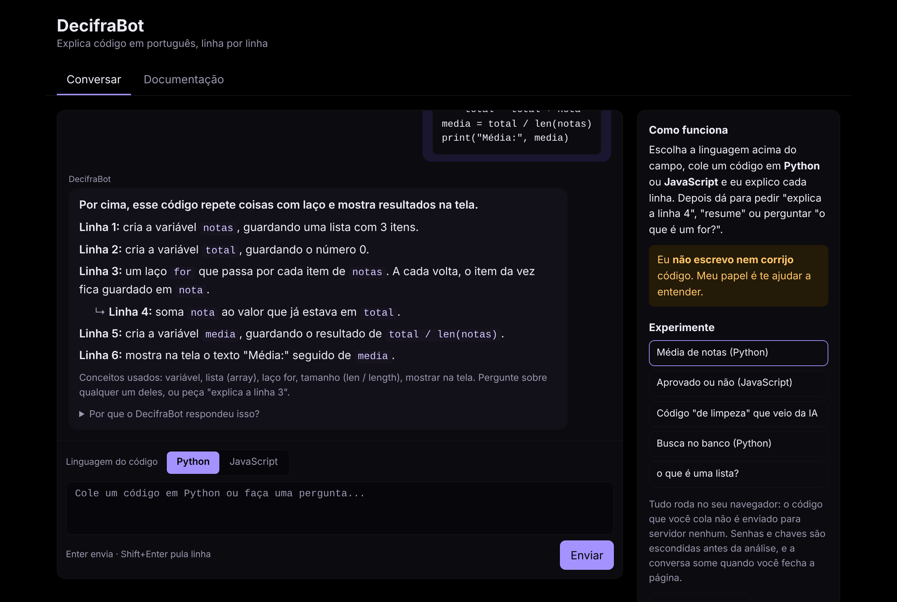
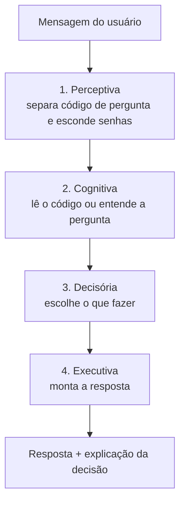

# DecifraBot

Agente que explica código Python e JavaScript linha por linha, em português simples, para quem está começando a programar.

| | |
|---|---|
| **Aluno** | Davi Vieira Lima |
| **RGM** | 39538061 |
| **Disciplina** | Tendências em Ciência da Computação, Unidade IV (Agentes e Ética) |
| **Professora** | Kadidja Valéria |
| **Instituição** | UDF Centro Universitário |

**Versão online:** https://davilima11.github.io/Tendencias_CienciaComputacao/unidade4-ProjetoA1/



## Atividades da unidade

| Data | Atividade | Onde está |
|---|---|---|
| 05/11 | Criação de agentes de IA | [Arquitetura do agente](documentacao/2-arquitetura-do-agente.md) |
| 12/11 | Chatbot com a especificação | [Especificação](documentacao/1-especificacao.md) e o site |
| 19/11 | Viés algorítmico e responsabilidade social | [Ética e viés](documentacao/3-etica-e-vies.md) |
| 26/11 | Projeto final e repositório | Esta pasta e [Testes e curadoria](documentacao/4-testes.md) |

## Sumário

1. [Introdução](#1-introdução)
2. [Problema](#2-problema)
3. [Objetivos](#3-objetivos)
4. [Tecnologias](#4-tecnologias)
5. [Arquitetura do agente](#5-arquitetura-do-agente)
6. [Memória](#6-memória)
7. [Privacidade e LGPD](#7-privacidade-e-lgpd)
8. [Viés e mitigação](#8-viés-e-mitigação)
9. [Testes e resultados](#9-testes-e-resultados)
10. [Vantagens e limitações](#10-vantagens-e-limitações)
11. [Como rodar](#11-como-rodar)
12. [Estrutura de pastas](#12-estrutura-de-pastas)
13. [Referências](#13-referências)

## 1. Introdução

O DecifraBot é um chatbot em que a pessoa cola um código e recebe a explicação de cada linha. Ele também avisa quando o código faz algo perigoso e responde dúvidas como "o que é um for?". A documentação segue o fluxo de trabalho de chatbots do SERPRO.

## 2. Problema

Com a IA, ficou fácil conseguir código pronto, e muita gente usa sem entender. Quem está aprendendo não aprende nada, e rodar código desconhecido é arriscado: ele pode apagar arquivos ou ter uma senha escrita no meio.

## 3. Objetivos

**Geral:** ajudar a pessoa a entender um código antes de usar.

**Específicos:**

- Explicar Python e JavaScript linha por linha, sem jargão.
- Avisar sobre trechos perigosos.
- Esconder senhas e chaves antes de analisar.
- Recusar escrever ou corrigir código.
- Admitir quando não sabe, em vez de inventar.

## 4. Tecnologias

| Tecnologia | Para quê |
|---|---|
| Python | O agente inteiro |
| `ast` e `esprima` | Ler código Python e JavaScript |
| TF-IDF (feito à mão) | Entender as perguntas |
| Streamlit | Versão para rodar no computador |
| Pyodide + GitHub Pages | Versão online, com o Python rodando no navegador |
| pytest | Testes automatizados |

Não usei API de IA generativa: um modelo poderia inventar uma explicação errada, e um iniciante não perceberia.

## 5. Arquitetura do agente



A camada decisória escolhe entre explicar, pedir para trocar a linguagem, recusar ou admitir que não entendeu. Toda resposta mostra o porquê da decisão. Detalhes em [Arquitetura do agente](documentacao/2-arquitetura-do-agente.md).

## 6. Memória

| Nível | O que guarda |
|---|---|
| Curta | As últimas 6 mensagens, sem o código |
| Média | O último código e a linguagem escolhida, para responder "explica a linha 4" |
| Longa | Nada. Fechou a página, tudo some |

## 7. Privacidade e LGPD

- Senhas, chaves de API, CPF e cartão são trocados por `***` antes da análise.
- No site, o código não sai do navegador.
- Mensagem com senha fora de um código é descartada.

## 8. Viés e mitigação

O principal viés: quem pergunta sem o termo técnico é entendido pior, e esse é justamente o iniciante. Para diminuir, o bot aceita erros de digitação e avisa quando não tem certeza. O limiar de confiança (0,40) foi escolhido testando perguntas que não estavam na base. A análise completa está em [Ética e viés](documentacao/3-etica-e-vies.md).

## 9. Testes e resultados

| Teste | Resultado |
|---|---|
| Testes automatizados | 59 de 59 passando |
| Perguntas novas (validação) | 15 de 16 entendidas |
| Perguntas fora do assunto | 10 de 12 rejeitadas |
| Tentativas de fazer o bot falhar | 12 casos, como pedir para corrigir código e colar `<script>` |

Detalhes em [Testes e curadoria](documentacao/4-testes.md).

## 10. Vantagens e limitações

| Vantagens | Limitações |
|---|---|
| Não tem custo nem chave de API | Ainda não foi testado com alunos iniciantes |
| O código não vai para servidor nenhum | Não explica classes, `lambda` e `async` |
| Toda explicação vem de uma regra que dá para conferir | Só explica Python e JavaScript |

## 11. Como rodar

Precisa de Python 3.10 ou mais novo. Dentro da pasta `unidade4-ProjetoA1`:

```bash
pip install -r requirements.txt
streamlit run app.py      # versão em Streamlit
python -m http.server     # versão web, em http://localhost:8000
python -m pytest          # testes
```

## 12. Estrutura de pastas

```
decifra/         o agente (4 camadas, memória, privacidade, TF-IDF e analisadores)
dados/           conceitos, perguntas e exemplos
documentacao/    especificação, arquitetura, ética e testes
pagina/          estilo, script e bibliotecas da versão web
testes/          testes com pytest
app.py           versão em Streamlit
index.html       versão web
```

## 13. Referências

**Material da disciplina**

- VALÉRIA, Kadidja. *Guia de Estudos A1: Criação de Agentes de IA e Ética Aplicada*. Tendências em Ciência da Computação. UDF Centro Universitário, 2026.

**Desenvolvimento de chatbots e legislação**

- SERPRO. *Desenvolvendo Chatbots: fluxo de trabalho*. Disponível em: https://serprobots.estaleiro.serpro.gov.br/docs/dev/
- BRASIL. Lei nº 13.709, de 14 de agosto de 2018. Lei Geral de Proteção de Dados Pessoais (LGPD). Disponível em: https://www.planalto.gov.br/ccivil_03/_ato2015-2018/2018/lei/l13709.htm

**Tutoriais e guias**

- PYTHON SOFTWARE FOUNDATION. *ast — Árvores de Sintaxe Abstrata*. Documentação oficial do Python em português. Disponível em: https://docs.python.org/pt-br/3.9/library/ast.html
- FREECODECAMP. *Como processar dados textuais usando o TF-IDF em Python*. Disponível em: https://www.freecodecamp.org/portuguese/news/como-processar-dados-textuais-usando-o-tf-idf-em-python/
- STREAMLIT. *Build a basic LLM chat app* (tutorial oficial para montar um chat). Disponível em: https://docs.streamlit.io/develop/tutorials/chat-and-llm-apps/build-conversational-apps
- PYODIDE. *Getting started* (guia de início). Disponível em: https://pyodide.readthedocs.io/en/stable/usage/quickstart.html
- TESTDRIVEN.IO. *Running Python in the Browser with WebAssembly*. Disponível em: https://testdriven.io/blog/python-webassembly/

**Ferramentas e bibliotecas usadas**

- esprima-python (leitura de código JavaScript). Disponível em: https://github.com/Kronuz/esprima-python
- Pyodide (Python no navegador, usado na versão web). Disponível em: https://pyodide.org
- Streamlit (interface da versão em Python). Disponível em: https://streamlit.io
- marked (exibição da documentação no site). Disponível em: https://marked.js.org
- Mermaid (diagramas da documentação). Disponível em: https://mermaid.js.org
- scikit-learn (usado só no teste que confere o TF-IDF feito à mão). Disponível em: https://scikit-learn.org
- pytest (testes automatizados). Disponível em: https://pytest.org

## Uso de IA neste projeto

Ferramenta de IA usada como apoio: Claude (Anthropic).
