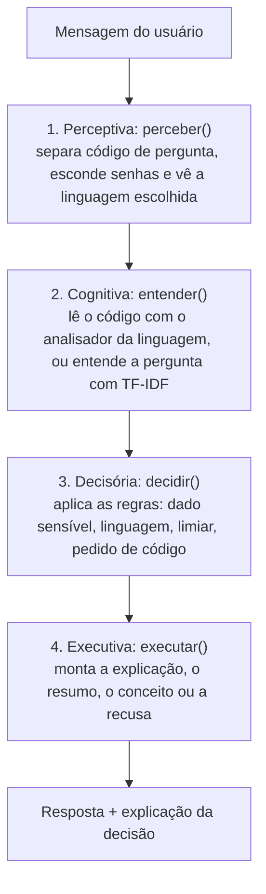

# Arquitetura do agente

## Por que o DecifraBot é um agente e não só um gerador de texto

O guia da Unidade IV diferencia modelo generativo e agente por quatro pontos: ação, foco, contexto e autonomia. Comparando com o DecifraBot:

| | Modelo generativo | DecifraBot |
|---|---|---|
| Ação | Responde a um prompt isolado | Decide entre explicar, pedir para trocar a linguagem, avisar sobre perigo, recusar ou admitir que não sabe |
| Foco | Gerar texto | Fazer a pessoa entender o código |
| Contexto | Não lembra da conversa | Lembra do último código, para responder "explica a linha 4" |
| Autonomia | Nenhuma | Pequena: esconde senhas sozinho e percebe quando o código não é da linguagem escolhida, mas nunca executa nem altera o código |

## As 4 camadas

Cada camada é um método da classe `Agente`, em `decifra/agente.py`.

**Perceptiva.** A primeira coisa é decidir se a mensagem é código ou pergunta. Se for código, duas coisas acontecem antes de qualquer análise. Primeiro, senhas, chaves de API e senhas dentro de endereços de conexão são trocadas por `***`. Depois, a camada pega a linguagem que a pessoa escolheu no seletor (Python ou JavaScript; começa em Python). Não tem modo automático: quem decide a linguagem é a pessoa. Mesmo assim, o bot dá uma olhada no código, tentando ler com os dois leitores e contando "marcas" de cada linguagem (como `def` e `:` no fim da linha para Python, ou `let`, `;` e `{` para JavaScript). Isso serve só para avisar: se o código parece Java, C, HTML, SQL ou PHP, ele diz que ainda não explica essas linguagens.

Se a mensagem for pergunta, a camada procura número de linha ("linha 4"), troca de linguagem escrita ("é javascript", que muda o seletor também), termos técnicos (`for`, `def`, `const`...) e verbos de pedido ("faz", "corrige", "arruma") acompanhados de "código" ou "pra mim".

**Cognitiva.** Para código, o analisador da linguagem transforma o texto numa árvore (o Python faz isso com o módulo `ast`, que já vem com ele, e o JavaScript com a biblioteca `esprima`). Depois percorre essa árvore e, para cada estrutura que reconhece, escolhe uma frase de explicação e preenche com os nomes do código da pessoa.

Para pergunta, o texto é comparado com as 160 frases de exemplo da base usando TF-IDF com pedaços de 2 a 4 letras, o que aguenta bem erro de digitação. Escrevi o TF-IDF à mão, sem biblioteca, e um teste confere que ele dá exatamente o mesmo resultado do scikit-learn. Um termo técnico na pergunta vale mais que a frase parecida: "não entendi o for" é sobre o `for`, mesmo lembrando um agradecimento.

**Decisória.** As regras, na ordem:

1. Tem senha ou cartão numa mensagem que não é código? Descarta.
2. É código de uma linguagem que eu não sei? Avisa.
3. O leitor da linguagem escolhida não conseguiu ler, mas o da outra conseguiu? Pede para trocar no seletor e guarda o código. Quando a pessoa troca, ele explica esse código.
4. Nenhum dos dois leitores conseguiu? Diz em que linha deve estar o erro.
5. É código? Explica na linguagem escolhida. Se o código também funciona na outra e tem mais cara dela, avisa.
6. Pediu uma linha, resumo ou troca de linguagem, mas não tem código guardado? Pede o código.
7. Tem verbo de pedido junto com "código"? Recusa.
8. Confiança abaixo de 0,40? Admite que não entendeu.
9. Entre 0,40 e 0,55? Responde, avisando que pode ter entendido errado.
10. Acima de 0,55? Responde direto.

**Executiva.** Monta a resposta: o resumo de uma frase, as explicações de cada linha (com recuo para o que está dentro de blocos), os alertas, os conceitos usados e a explicação da decisão.

### Exemplos reais passando pelas camadas

| Mensagem | Perceptiva | Cognitiva | Decisória |
|---|---|---|---|
| `let total = 0;` com JavaScript escolhido | linguagem escolhida: JavaScript | 2 de 2 instruções reconhecidas | explicar |
| `let total = 0;` com Python escolhido | o leitor de Python não lê, o de JavaScript lê | nenhuma | pedir para trocar o seletor e guardar o código |
| `x = 5` | vale nas duas linguagens | 1 de 1 reconhecida | explicar na linguagem escolhida |
| `api_key = "sk-proj-..."` | chave trocada por `***` | o analisador só vê `***` | explicar, com alerta |
| "o que é uma lista?" | termo técnico "lista" | conceito lista, confiança 0,80 | explicar o conceito |
| "não entendi o for" | termo técnico "for" | conceito for (o TF-IDF sozinho achava "agradecimento") | explicar o conceito |
| "faz esse código pra mim" | verbo de pedido + "código" | o TF-IDF achava "resumo" | recusar |
| "quanto custa um notebook" | nada | "tamanho", confiança 0,41 | responder com dúvida |

O último exemplo é um erro que o bot comete: a pergunta não tem nada a ver com programação, mas passou do limiar por pouco. Pelo menos a resposta vem com o aviso "Acho que você está perguntando sobre tamanho. Se não for isso, me pergunta de outro jeito." Isso está discutido na análise de viés.

## Memória

| Nível | No DecifraBot | Para quê |
|---|---|---|
| Curta | As últimas 6 mensagens. Código entra só como "[código Python com 7 linhas]" | Manter a conversa coerente sem duplicar o código |
| Média | A linguagem escolhida, o último código (já com senhas escondidas), a explicação e o código que está esperando a troca de linguagem | Responder "explica a linha 4", "resume", explicar o código depois da troca e mostrar o exemplo do conceito na linguagem escolhida |
| Longa | **Não existe** | |

Não ter memória longa foi uma decisão. O código de uma pessoa pode ter coisas do trabalho dela, nomes de arquivos, endereços internos. Guardar isso entre conversas criaria um risco sem nenhum ganho para quem só quer entender um trecho. Quando a pessoa fecha a página ou clica em "Limpar conversa", tudo some.

## Interpretabilidade

O guia cita Murta (2023): a confiança no agente depende de ele conseguir explicar por que tomou a decisão. Toda resposta tem um botão "Por que o DecifraBot respondeu isso?". Para código, ele mostra por que escolheu a linguagem e quantas instruções reconheceu:

> Li como JavaScript porque só o leitor de JavaScript conseguiu ler o código. Reconheci 9 de 9 instruções.

Esse "reconheci 9 de 9" ajuda a pessoa a saber o quanto confiar na explicação. Se aparecer "reconheci 5 de 9", ela sabe que tem partes que ficaram sem explicação.

## Por que não usei IA generativa

Pensei em mandar o código para um modelo como o ChatGPT ou o Claude explicar. Ele explicaria até código avançado, mas desisti por três motivos. Um modelo generativo pode inventar uma explicação errada com toda a confiança, e um iniciante não tem como perceber. O código da pessoa iria para o servidor de uma empresa. E teria custo e uma chave de API para proteger.

Tem também uma questão de coerência. A motivação do projeto é justamente gente usando resposta de IA sem entender. Um explicador que também pode inventar coisas seria o mesmo problema com outra cara. Por regras, o DecifraBot só fala do que reconhece com certeza, e cada frase dá para rastrear até a regra que a gerou.

O guia cita Mello (2024) sobre equilibrar arquitetura rígida (controle e segurança) com flexibilidade. O DecifraBot fica do lado rígido nas explicações de código e mais flexível nas perguntas, onde o TF-IDF entende o jeito de cada um escrever. O custo é que ele não explica tudo: classes, `lambda`, `async` e callbacks mais complexos ficam com "ainda não sei explicar".

## Versão web

Para a professora e os colegas testarem sem instalar nada, o DecifraBot também roda no GitHub Pages. O Pages só hospeda arquivos estáticos e não roda Python, então usei o Pyodide, que é o Python compilado para rodar dentro do navegador. O site carrega exatamente os mesmos arquivos da pasta `decifra/`, sem nenhuma reescrita. Por isso, o que os testes conferem é o que roda no site.

Isso também reforça a privacidade: no site, o código que a pessoa cola é analisado no próprio navegador dela e não vai para servidor nenhum. O GitHub só entrega os arquivos da página.

A única peça nova é `decifra/ponte.py`, que transforma as respostas em JSON para a página mostrar. A página monta todo o texto que vem do código do usuário como texto puro, nunca como HTML, para que um código com `<script>` dentro de uma string não seja executado.

## Como adicionar uma linguagem

As explicações ficam em `decifra/textos.py` e são usadas pelos dois analisadores. Por isso, o `for` do Python e o `for...of` do JavaScript geram exatamente a mesma frase, e um teste confere isso. Para uma linguagem nova, o trabalho é escrever o analisador (a parte que lê a linguagem e sabe o que é cada estrutura) e registrar ele em `ANALISADORES`, no `agente.py`. A maior parte do texto já existe. Depois é só rodar `python pagina/manifesto.py` para o site carregar o arquivo novo (um teste avisa se isso for esquecido).

## Referências

- VALÉRIA, Kadidja. *Guia de Estudos A1: Criação de Agentes de IA e Ética Aplicada*. UDF Centro Universitário, 2026. Os autores Murta (2023) e Mello (2024) foram citados a partir desse guia.
- PYTHON SOFTWARE FOUNDATION. *ast — Abstract Syntax Trees*. Disponível em: https://docs.python.org/3/library/ast.html
- esprima-python. Disponível em: https://github.com/Kronuz/esprima-python
